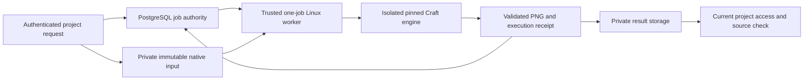

# Authenticated Craft engine jobs

27 October 2026. Continuation of [online engine design](ONLINE-ENGINE-DESIGN.md) and the [implementation plan](ENGINE-JOBS-PLAN.md). Kimi independently audited the broader product requirements in [COMPLETION-AUDIT.md](COMPLETION-AUDIT.md).

## What this increment connects

The application now has a default-off API for a saved project's PhotoCraft or VectorCraft native file to produce a private PNG preview. PostgreSQL records the immutable source, input, exact engine capability, attempt and result. A trusted Linux worker pulls one job over authenticated HTTP and uses the existing isolated runner. A failed or lost response never starts another execution automatically.

This is render-preview transport. It does not infer layers from a flyer, convert PNG lettering into type, mutate the Banner canvas, or automate the separate [manual companion wording workflow](COMPANION-WORDING.md). The native input is a separately submitted file associated with a saved project; the API does not assert that this file reproduces every layer of that project.

The HTTP contract is documented in [ENGINE-JOBS-PLAN.md](ENGINE-JOBS-PLAN.md); implementation details and commands are in [server authority](ENGINE-JOBS-SERVER.md) and [worker transport](ENGINE-JOBS-WORKER.md). No new UI button, auto-retry policy or background daemon is claimed by these APIs. The CLI runs exactly one pull and exits with a content-free known/uncertain outcome.

## Authority and recovery

Submission binds an owner-scoped request UUID to the exact payload, canonical saved source and current client access. The server selects identities, keys, limits and pinned capability. Clients cannot submit executable commands, output paths, remote URLs or their own tenant authority.

Claiming is exclusive and commits before execution. Claim credentials are random and stored only as hashes. Lost claim acknowledgement means a held attempt, never another claim. Input/output use a dedicated private bucket and conditional immutable creation. Result validation checks actual bytes, PNG dimensions, all identity/pin fields and current saved source; a final locked check prevents cancellation or source changes during upload from publishing success. Lost completion acknowledgement retains potentially accepted bytes. Deleting or reassigning a source never grants access to historical output.

Queued expiration is `expired`; unknown running/cancelling expiration is `uncertain`. Unconfirmed native cleanup remains `uncertain` even when a rejected subprocess promise settles. Both the durable database state and worker filesystem receipts prevent automatic rerun. A separate operator reconciliation/retention policy is still required before production activation; this increment deliberately adds no destructive cleanup or retry shortcut.

Input and output are each limited to 16 MiB, JSON transfer to 24 MiB, preview dimensions to 2048 and execution to 120 seconds. Transport also bounds chunk count and elapsed reads. These are per-attempt bounds, not a proven global concurrency or hosted memory budget. Workers require private operator-owned durable parent directories; these checks do not defend against a hostile administrator or another process with the same trusted account.

## Review and evidence status

Independent review is recorded in [ENGINE-JOBS-REVIEW.md](ENGINE-JOBS-REVIEW.md). During implementation it found and drove corrections for unknown container termination, installed Pages request compatibility/prebuffering, and retained per-chunk abort reactions. The final review accepts this bounded local snapshot with no unresolved P1/P2 findings; all 31 source hashes and both retained PNGs were independently reconciled.

The owned PostgreSQL proof applies migration `483_banner_engine_jobs.sql` automatically only to a newly created loopback cluster; it never reads `.env` or `DATABASE_URL`. It exercises real authority SQL, actual endpoint modules, authenticated worker HTTP and real Linux execution. User sessions/rate-store and private object storage are explicitly synthetic fixtures. Hosted authentication, Neon/R2 behavior and production Linux execution are not established by that proof.

Run `node scripts/banner-studio/prove-engine-jobs.mjs` for a fresh timestamped evidence directory. It retains source hashes and exact PNGs, then stops and removes only its owned disposable database. Native runner cleanup verifies its owned containers. Failed development proof directories remain historical evidence and must not be substituted for the final acceptance run.

## Final local evidence — 27 October 2026

- **370 unique passing tests across 17 files**: 326 engine/companion regressions across 15 files, 32 Pages guard/build tests, and 12 actual PostgreSQL/native integration cases. No skips in these runs. The suites are disjoint; earlier worker/reviewer counts overlap and are not added.
- Regression reports: `output/editable-artwork-engine-jobs/final-regression-20261027.json` and `final-pages-regression-20261027.json` in the same directory. The latter includes an actual minimal Nitro `cloudflare_pages` build with the dashboard plugin order. It is not a full dashboard build or hosted runtime test.
- Final SQL/native evidence: `output/editable-artwork-engine-jobs/proof-2026-10-27T05-26-57-516Z/postgres-proof.json`, `postgres-proof.log` and `native-http-evidence.json`. All **31 recorded source/runtime hashes** were unchanged during the proof. The additive migration was applied only to the owned disposable PostgreSQL 14.19 cluster; cleanup is confirmed.
- Actual production endpoint modules accepted submission, worker claim/input/completion, status, private output and queued cancellation under fixture user sessions/rate-store. Both native Linux engines succeeded. PhotoCraft returned 256×256 PNG with 27,590 partial-alpha and 37,180 transparent pixels; VectorCraft returned 640×360 PNG with 11,016 partial-alpha and 207,661 transparent pixels. Exact private PNGs and attempt receipts are retained in each engine subdirectory. This validates preview byte transport and alpha retention for the fixtures, not arbitrary flyer reconstruction or editable image import.
- SQL cases cover payload-bound concurrent admission, exclusive claims, tenant/current-access isolation, source/cancel races during output storage, wrong bytes/pins, lost claim/completion acknowledgements, expiry and durable uncertainty for unconfirmed running/cancelling cleanup. Worker/unit tests separately exercise real adapter/runner composition with controlled Docker failures.
- Scoped ESLint for the new/changed server, worker, shared, proof, guard and feature-page files passes; `git diff --check` passes. The existing Vite `__dirname` warning remains. No global typecheck or full production build is claimed.

The [Pages entry guard](ENGINE-JOBS-PAGES.md) bounds these route families before the installed preset prebuffers input, preserving the original trusted request for the route helper. Its checked build transform rejects an unreviewed Nitro preset change. Review corrections also preserve unknown native cleanup as uncertain and bound transport chunk overhead. See [independent review](ENGINE-JOBS-REVIEW.md) for the final acceptance scope.

Source at this checkpoint: HEAD `47ec30c3522f6ab660d730776709770c8a22d7c8` includes freshly reconciled `origin/main` `4469d6a2fb873c2d7b90ece9a359dd571def0ba2`. All changes remain local and uncommitted; the shared dirty worktree and parent checkout are preserved. The owned HTTP fixture closes, the disposable database stops and is removed, and no labelled engine container remains.

Final repository check: `origin/main` advanced during this increment to `5d17d2fa4012a011f943df8a80c579923f163dd8` (HEAD one ahead/one behind). Its only new change is `docs/runbooks/ita-dealer-completion-ledger-20261026.md`, with no overlap in the engine source. The recorded test hashes remain current; reconcile this documentation-only advancement before further implementation or release. No merge or dirty-worktree stash/reset was performed.

## Activation remains separate

Nothing was deployed or activated. The API requires `BANNER_ENGINE_ENABLED=true`, exact trusted capability registrations, a dedicated private `BANNER_ENGINE_BUCKET`, a strong separate service credential, TLS and current saved project authority. The worker requires the measured image/binary/proof manifests and durable private staging/attempt storage. Production rollout still needs a current reconciled candidate, full build/guarded release checks, actual hosted auth/storage/database/worker proof, resource admission, operational reconciliation/retention and monitoring.

No preview/production deployment, public bucket, live migration, subscription purchase or client publication was performed. PhotoCraft and VectorCraft local native execution does not imply EffectCraft, FilmCraft, FigCraft or SoundCraft deployment. OpenUI remains the separate documented rollout.
