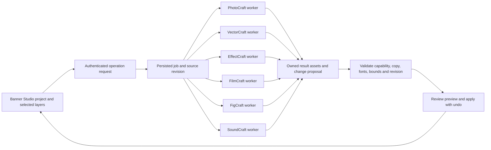

# Online creative engines

27 October 2026. Paul clarified that automated jobs must work without access to a user's computer, with optional PhotoCraft, VectorCraft, EffectCraft, FilmCraft, FigCraft and SoundCraft operations returning to Banner Studio. This is the proposed hosted extension of the implemented local PhotoCraft bridge. No VPS, hosted worker, embedded editor or additional engine adapter has been provisioned by this increment.

## Recommended shape

Keep Banner Studio's saved project, native layers, approved copy, managed QR, revision checks and undo as the application authority. Run interactive changes and review in the browser. Queue heavy or unattended engine operations to isolated Linux workers. Serve optional upstream WebAssembly editors as separately versioned browser tools only after their storage and document bridge are proven. A local desktop companion remains optional.

The existing platform owns identity, tenancy, assets and job state. The AI submits typed operations rather than arbitrary shell commands. Each engine runs in a separate bounded job workspace with explicit input assets, no customer credentials, controlled network access, pinned binaries and a licensed font manifest. Result ingestion checks job/attempt identity, hashes, schema, layer identities and the current project before producing a proposal. A process exit or transport timeout is not proof that a job failed safely; retain execution state and reconcile before retrying.

Use the existing catalogue for AI inference and the existing execution ledger/job patterns for orchestration. Deterministic render/conversion engines have a separate versioned capability manifest; they are not AI models. Reuse the Dissector job protections where applicable, but do not assume its current schema already supports these engine jobs. A browser iframe does not supply authentication, autosave, AI command transport or cross-editor undo.

## Engine contracts and current evidence

| Engine | Candidate operations | Verified locally | Unproved or restricted |
|---|---|---|---|
| PhotoCraft | Raster edits, independent masks, layered documents, native lettering | Installed 0.16.0 synthetic text/mask/PSD tests; bounded Banner subset export and wording-only return proposal | Hosted Linux execution, browser save bridge, full typography/transform return, arbitrary PSD compatibility and print acceptance |
| VectorCraft | Paths, panels, badges, maps, scalable illustrations | Installed/matching 0.17.0 native and SVG proof; text, transforms, clips and opacity masks | No Banner adapter; plain SVG changes structure and requested Inter Bold substituted SemiBold; matching fonts required |
| EffectCraft | Native title animation, motion graphics, effects, rendered sequences | Matching 0.17.0 headless text/easing/alpha and sampled editable Lottie round trip | No Banner animation adapter, hosted runtime or independent browser Lottie acceptance; unsupported effects must be reported |
| FilmCraft | Scene assembly, footage/audio timelines, final video | Matching 0.13.0 native title editing/undo and alpha video proof | Tested OTIO return loses editable titles; no general lossless timeline round trip or hosted adapter |
| FigCraft | Reusable frames, layouts, components, variants and interface prototypes | Official public capability/source review only; browser, CLI/MCP and self-hosted collaboration are documented | No installed/runtime proof or Banner/Page Studio adapter; component/variable/constraint round trips untested |
| SoundCraft | Voice-track editing, music/effects mixing, editable sessions, stems and soundtrack masters | Official public capability review only; release lists headless CLI and self-hostable web build | No runtime/render proof or FilmCraft adapter; sample rate, timing, automation and plugin parity untested |

Repeated Banner → engine → Banner operations are the intended model, but only a declared subset may return as editable native layers. Keep engine-native documents as versioned derived assets so unsupported effects/timelines are not silently discarded. Return flattened previews or renders explicitly as raster/video assets where a native mapping is absent. Never call a PNG, outlined glyph or rendered clip native editable text.

The common request should bind project/client, immutable source revision and hash, selected stable layer IDs, requested operation, exact copy, engine/version, input assets/font hashes, bounds, output formats and execution limits. The result should bind the same request and attempt, contain owned artifact IDs/hashes, render previews, explicit proposed changes, unsupported/loss reports and verification evidence. Do not claim a portable neutral document preserves every engine feature. The current `shared/bannerDocumentBridge.ts` is PhotoCraft-specific despite its shared location; the other adapters are future work.

Initial human review remains required before applying external creative changes. If later automation permits automatic application, it needs an explicit operation policy, the same validation/revision boundary and retained undo/history; provider output alone is never authorisation.

## Why hosting does not require decompilation

Official source describes PhotoCraft and VectorCraft as Rust applications with browser/WebAssembly builds and headless/automation interfaces. The pinned PhotoCraft web distribution is static, processes documents on the visitor's device and explicitly lacks server document storage and web autosave. VectorCraft documents a headless PDF export command and a separate static web build. Therefore browser hosting and unattended server execution are distinct integration tasks. The Linux worker deployment must be tested independently of our macOS evidence.

Sources checked 27 October 2026: [Crafting Apps](https://getartcraft.com/apps), [PhotoCraft 0.16.0 source](https://github.com/storytold/photocraft/tree/v0.16.0), [PhotoCraft web hosting](https://github.com/storytold/photocraft/blob/v0.16.0/packaging/web/README.md), [VectorCraft 0.17.0 source and CLI examples](https://github.com/storytold/vectorcraft/tree/v0.17.0), [VectorCraft web hosting](https://github.com/storytold/vectorcraft/blob/v0.17.0/packaging/web/README.md). Code is documented as MIT OR Apache-2.0; fonts, dependencies and brand assets have separate notices. Reuse pinned open source with an attribution/dependency inventory, not a decompiled proprietary replica. No upstream code or fonts were incorporated in this increment.

FigCraft and SoundCraft were added at Paul's request during this checkpoint. Sources checked 27 October: [FigCraft capabilities and releases](https://getartcraft.com/apps/figcraft), [FigCraft source](https://github.com/storytold/figcraft), [SoundCraft capabilities and releases](https://getartcraft.com/apps/soundcraft). These are upstream claims, not our integration evidence. FigCraft could support reusable campaign/UI layouts; its generated code is not automatically a valid Page Studio document. SoundCraft could mix configured AI-generated or supplied audio; it is not itself an established speech/music generation model. Retain audio sessions/stems and an explicit sample-rate/channel/timebase contract when handing a mix to FilmCraft. External plugins and fonts must be pinned and available to the hosted worker; unsupported ones must reject or be declared as rendered output.

## Print and runtime acceptance

Before online production, measure Linux memory/CPU/GPU needs and timeout behaviour using real page sizes. Start with CPU-capable bounded jobs; do not buy GPU capacity based on the presence of Rust or WebGPU alone. Native executables belong in separate compute, not inside the current Pages application runtime. Host selection and cost remain undecided until measurement; nothing has been purchased.

An accepted print export must independently verify physical size, bleed/trim boxes, supplied colour profile, fonts/embedding, image resolution, legal text, QR decoding and the chosen PDF/X or printer contract. Preserve an editable master separately. Current JPEG/PNG/native document and PDF capability tests are not press-ready acceptance. Add a page-layout/PDF engine only if it demonstrably fills a requirement; no DesignCraft/PdfCraft runtime acceptance has been performed.

Next measured slice after the current local checkpoint: define the engine-neutral request/result schema, build a bounded Linux PhotoCraft worker and a VectorCraft adapter behind it, then prove authenticated storage, save/reopen, cancellation, stale-job rejection and exact copy/QR preservation. EffectCraft and FilmCraft follow with explicit animation/timeline mappings. This is an execution sequence, not a claim that those hosted integrations already exist.
