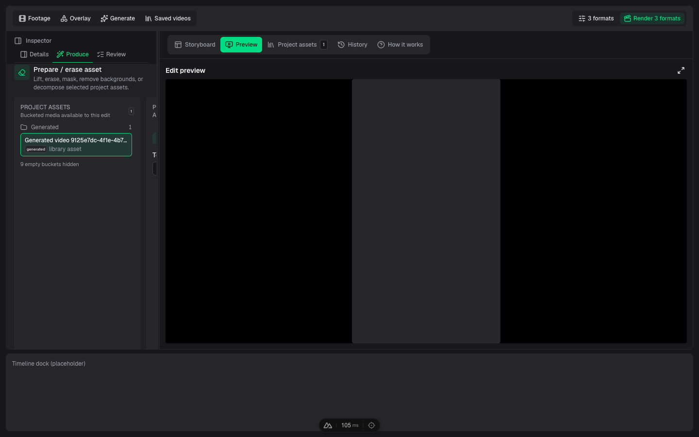
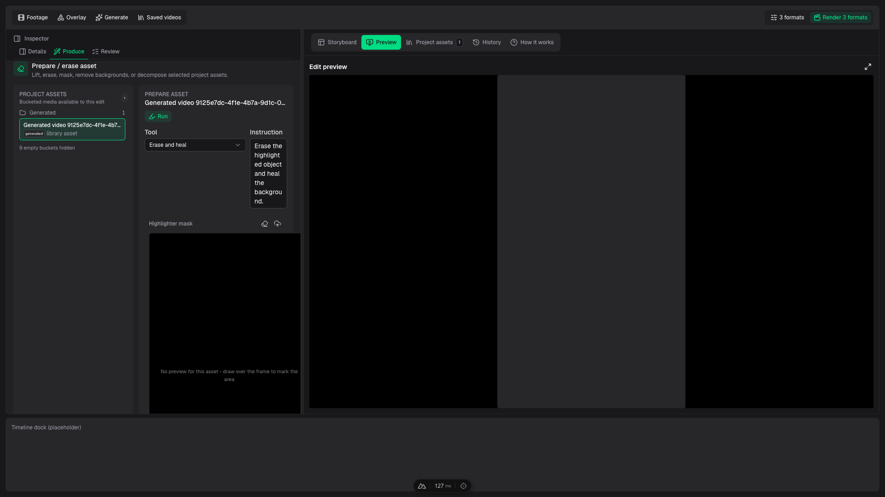
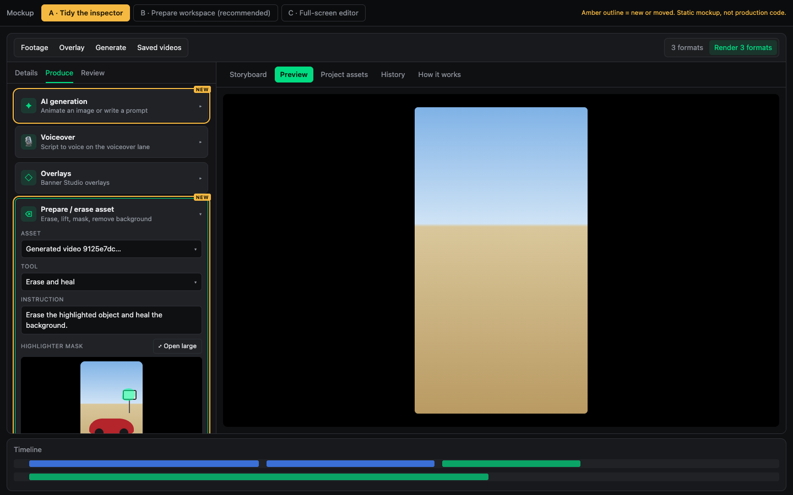
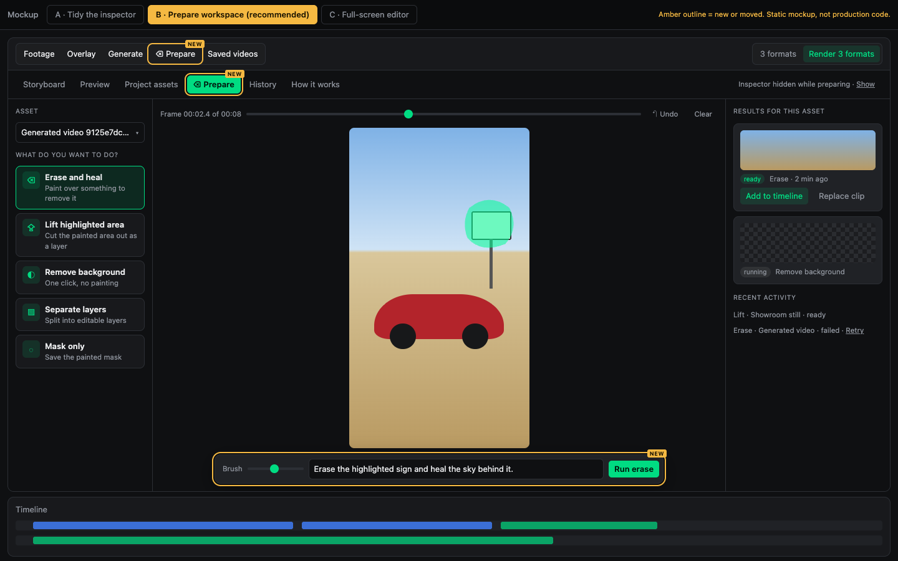
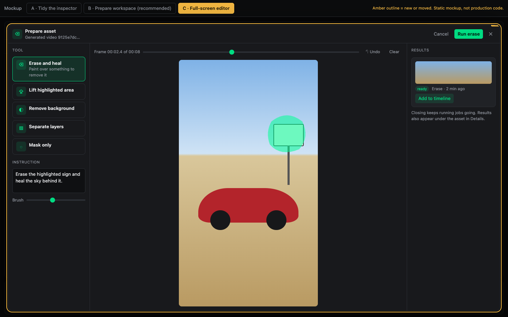

# Video Studio — "Prepare / erase asset" layout R&D

Date: 2026-11-24 · Status: **proposal, nothing implemented** · Decision needed from Paul: pick A, B or C.

## Recommendation

**Build option B: a "Prepare" workspace that uses the main stage for masking**, and ship the two-line breakpoint fix from option A first as a hotfix.

Erasing and masking is a "look at the picture and paint on it" job. Every comparable editor puts that on the main canvas and keeps only settings in a side panel. Today it sits about three screens down a 310px panel, so people neither find it nor can use it once they do.

Open the mockups: [`mockups.html`](./mockups.html) (click the A / B / C buttons), or see the images below.

## What is wrong today

Screenshots are from the real components (`VideoStudioWorkbench`, `VideoStudioInspector`, `MediaAssetHarness`) mounted on a throwaway local page with mocked API data. The AI-generation composer was only partly rendered under the mock, so in production the Prepare section starts further down than measured here.

| Viewport | Inspector width | Instruction box width | Mask canvas | Produce tab length |
|---|---|---|---|---|
| 1920 × 1080 | 309px (default) | **20px** | 347px, pushed off the panel | 4,038px in a 766px window |
| 1440 × 900 | 309px (default) | **20px** | 322px, pushed off the panel | 3,994px in a 586px window |
| 1280 × 800 | 309px (default) | **20px** | 286px, pushed off the panel | 3,930px in a 486px window |
| 1024 × 768 | 309px | 251px (stacks correctly) | 274px, fits | 3,075px in a 454px window |
| 1920 × 1080 | 639px (dragged to max) | **81px** — matches Paul's screenshot | 347px, clipped 19px | 2,916px |
| 1440 × 900 | 536px (max allowed) | **20px** | clipped 97px | 3,652px |

Default inspector, 1440 wide — the Prepare column is off the edge of the panel:

Inspector dragged to its widest, 1920 wide — the state in Paul's screenshot:

Other captures: [1920 default](./screenshots/current-xl-1920-prepare.png), [1280](./screenshots/current-md-1280-prepare.png), [1024](./screenshots/current-sm-1024-prepare.png), [1440 wide](./screenshots/current-lg-1440-wide-prepare.png), [top of Produce tab](./screenshots/current-lg-1440-top.png).

### Causes

1. **Screen-width breakpoints inside a narrow panel.** `MediaAssetHarness.vue` uses `xl:grid-cols-[260px_minmax(0,1fr)]` and `VideoStudioPrepareAssetPanel.vue` uses `xl:grid-cols-[220px_minmax(0,1fr)]`. `xl:` fires when the *screen* is 1280px or wider, but the panel is 280–640px (capped at 38% of the workbench). So on any desktop the panel splits into 260px + 220px fixed columns and the instruction box gets what is left: 20–81px. Below 1280px it stacks and is fine, which is why the smaller screen looks better than the bigger one.
2. **The mask canvas has a fixed height** (`h-[min(64vh,620px)] min-h-[360px]`, 9:16), so it is 290–350px wide regardless of the column it sits in.
3. **Too much in one scroll.** The Produce tab holds six tools end to end with no index. Prepare starts at least 1,000px down and is itself about 2,200px tall.
4. **No entry point.** Nothing in the header, the Studio tools menu, the asset card or the selected-asset panel mentions erase, lift or background removal. The only way to find it is to scroll.
5. **It has its own asset list.** The harness ignores the asset already selected in the studio and shows a second "Project assets" bucket list, so the user picks the asset twice.

### Other problems found on the way (any option should fix these)

- The mask canvas is always 540 × 960 with `object-cover`, and the mask upload endpoint does not resize. For a 16:9 or 1:1 asset the painted area likely will not line up with the picture. **Not verified with a real erase run** — worth one test before building.
- Masking uses the asset thumbnail only. Assets without a thumbnail show "No preview for this asset" and the user paints blind. There is no way to choose which frame of a video to mask. A stream endpoint already exists (`assets/[id]/stream.get.ts`) that a larger stage could use.
- No undo; only "clear all".
- Staff-facing screen shows internals: "Brush mask key" (a storage key), "Model catalogue … disabled by default", raw storage paths as derivative names.

## What lives in the side panel

Frequency is my reading of the workflow from the code, not usage data — there is no analytics on these controls.

| Tab | Feature | When it is used | How often |
|---|---|---|---|
| Details | Counts (assets, voice, overlays) | Glance | Constant, passive |
| Details | Selected asset: add to timeline, replace clip, generate from asset, captions | While assembling | High |
| Details | Clip inspector: split, delete, timing, caption style, overlay position/size | While editing | High |
| Produce | AI generation (what to make, prompt, source image, model) | Creating clips | High, early |
| Produce | Open storyboard | Planning | Once or twice per project |
| Produce | Voiceover (title, script, generate, add/replace) | After the cut is roughed in | Once or twice per project |
| Produce | Overlays (Banner Studio project, format, start, duration) | Finishing | A few times per project |
| Produce | **Prepare / erase asset** (asset list, tool, instruction, mask, brush, models, results, activity) | Cleaning a clip or still before using it | Occasional, but a long focused task each time |
| Produce | AI Producer (recipe, format, build draft plan, recent generations) | Starting a draft | Once per project |
| Produce | Add audio clip | Finishing | Occasional |
| Review | Adjusted edit review, review status | Before render | Once per version |
| Review | Render jobs (render, retry, publish, send to portal, save) | After render | Once per version |

Prepare is the only item that needs a large picture and pointer precision. Everything else is a form, and forms suit a side panel.

## How other editors handle it

| Product | Where you paint | Where settings live | How you get in |
|---|---|---|---|
| Photoshop Generative Fill | Selection on the main canvas | Floating task bar under the selection (prompt + Generate); variations in Properties | Appears as soon as there is a selection |
| Canva Magic Eraser / Magic Edit | Brush on the photo in the main editor | Brush size and prompt in the side panel | Select photo → Edit → tool tile |
| CapCut AI remove | Brush on the preview player | Brush type and size in the right panel | Select clip → Video → Basic → AI remove |
| Premiere Object Mask | Hover and click objects in the Program Monitor | Effect Controls panel | Tool in the toolbar |
| Runway | Old mask-based video inpainting was retired on 30 July 2026 in favour of prompt-only removal; image Erase and Replace still paints on a full canvas with a prompt beside it | — | Tool from the tools list |

Three things are common to all of them: painting happens on the main picture, the side panel holds only a few settings, and the entry point is attached to the selected clip or image. Runway's move suggests a prompt-only path ("remove the sign") is worth keeping as an alternative to painting.

Sources: [Canva Magic Eraser](https://www.canva.com/help/magic-eraser/), [Canva Magic Edit](https://www.canva.com/help/using-magic-edit/), [Canva brush gestures](https://www.canva.com/en_au/help/brush-gestures/), [Photoshop Generative Fill](https://helpx.adobe.com/photoshop/using/generative-fill.html), [Photoshop variations](https://helpx.adobe.com/photoshop/web/edit-images/retouch/get-similar-variations-with-generative-ai.html), [CapCut AI edit on PC](https://www.capcut.com/resource/remove-watermarks-objects-flaws-videos-ai-edit-capcut-pc), [CapCut object remover](https://www.capcut.com/create/ai-object-remover), [Premiere object masking](https://helpx.adobe.com/premiere/desktop/add-video-effects/work-with-masks/object-masking.html), [Runway video inpainting](https://runway.com/resources/ai-video-inpainting), [Runway Erase and Replace](https://runwayml.com/ai-magic-tools/erase-and-replace/).

## Options

### A · Tidy the inspector

Keep everything in the side panel. Stack Prepare in one column, replace the bucket list with an asset dropdown, make each Produce tool a collapsible card so the tab opens as a five-line index, and add an "Open large" button on the mask.

- **For:** smallest change; fixes the unreadable instruction box; the collapsed cards make every tool visible without scrolling.
- **Against:** the mask is still about 200px wide in a default panel, so real masking still needs "Open large" — which is option C by another name. Prepare remains inside Produce, where nobody looks for it.
- **Discoverability:** modest. Visible once you are on the Produce tab.
- **Effort:** about 1 day. The breakpoint fix alone is under an hour.

### B · Prepare workspace (recommended)

Add "Prepare" as a workspace tab beside Storyboard / Preview / Project assets / History, plus a Prepare button in the header group. The main stage becomes the mask canvas at the asset's real shape. Tools are a plain-language list on the left, the instruction and Run sit in a bar under the picture, results with "Add to timeline" sit on the right. The inspector hides while preparing; the timeline stays.

Entry points: the header button, the workspace tab, an "Erase / clean up…" action on the selected asset and on asset cards, and a line in the Studio tools menu. Each opens Prepare with that asset already chosen, which removes the second asset list.

- **For:** the canvas gets about 60% of the screen; the feature has a permanent, named place; it follows the pattern PR #959 set up (workspace tabs, and the phone tab strip picks the new tab up automatically); the timeline stays in view so "Add to timeline" has an obvious result.
- **Against:** one more workspace tab (six); the Prepare view must opt out of #959's "preview beside workspace" split, since the stage *is* the picture; needs a stacked layout below `lg`.
- **Discoverability:** high. Always on screen, and offered on the asset itself.
- **Effort:** about 4–5 days. State and API calls already live in `MediaAssetHarness`, and `VideoStudioPrepareAssetPanel` is presentational, so this is mostly re-layout plus entry points, canvas sizing to the asset's shape, and tests. Add about 2 days if frame picking for video and undo are included.

### C · Full-screen editor

The same three-column layout as B, opened as a full-screen dialog from "Erase / clean up…" on an asset. The workbench already uses this pattern for "Expand preview".

- **For:** self-contained, so the lowest risk to the #959 layout; easy to reuse from Banner Studio or the asset library later.
- **Against:** nothing on screen says it exists until an asset is selected; hides the timeline; dialogs suit short tasks, and waiting on a job in one is awkward.
- **Discoverability:** medium. Depends entirely on the entry buttons.
- **Effort:** about 3 days.

### Side by side

| | A · Tidy | B · Workspace | C · Full-screen |
|---|---|---|---|
| Mask canvas size (1440 wide) | ~200px | ~290 × 515px, grows with screen | ~390 × 700px |
| Instruction readable | Yes | Yes | Yes |
| Findable without scrolling | On Produce tab only | Always | Only via asset actions |
| Timeline visible while working | Yes | Yes | No |
| Risk to PR #959 layout | None | Low | None |
| Effort | ~1 day | ~4–5 days | ~3 days |

## Suggested order if B is chosen

1. **Hotfix (under an hour, can ship alone):** replace the two `xl:` grids with a single column and let the canvas width follow its container. This stops the 20px instruction box today.
2. Prepare workspace tab, header button, and layout.
3. Entry actions on the selected asset and asset cards; remove the duplicate asset list.
4. Canvas at the asset's real shape, video frame picker, undo. Run one real erase on a 16:9 asset first to confirm the mask-alignment concern.
5. Collapse the remaining Produce tools into cards (the useful half of option A).

Marketing pages (`features/index.vue`, `features/[slug].vue`) should mention erase and background removal when step 2 ships.

## Not done

- No refactor code. The local reproduction page was deleted and is not in this branch.
- Screenshots use mocked data, not a production project, because the local server was run without database access.
- The mask-alignment concern is from reading the code, not from a test run.
- Effort figures are estimates from reading the components, not from a spike.
